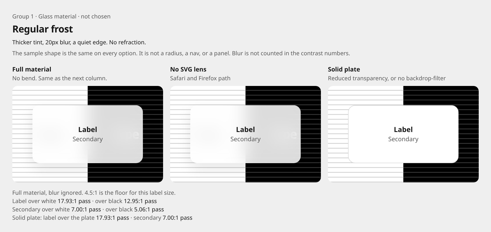
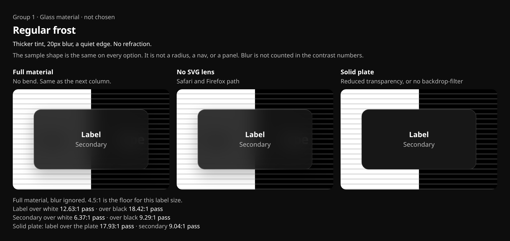
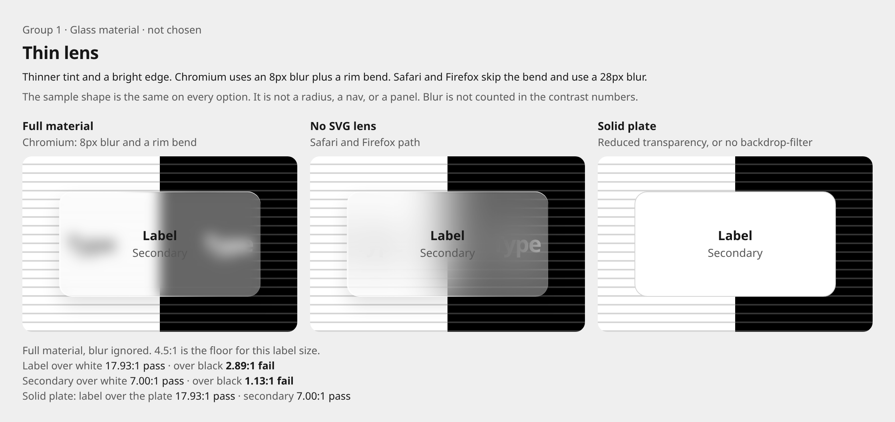
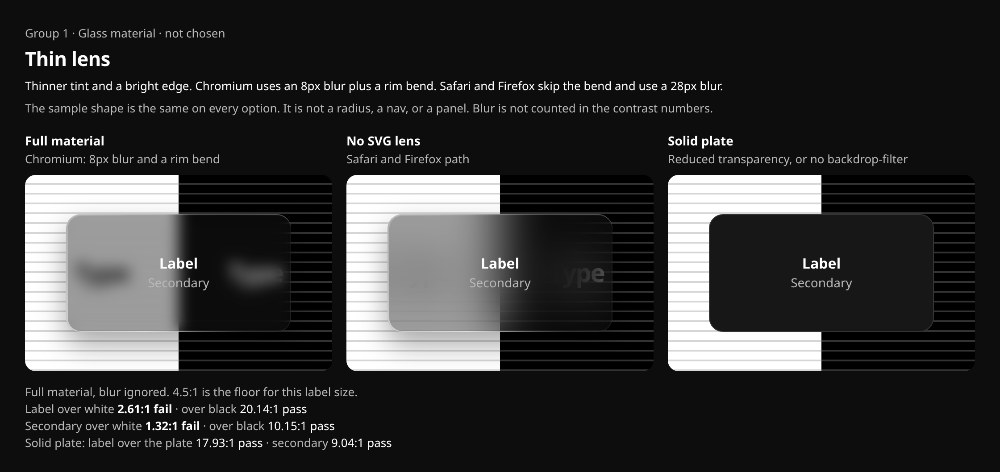
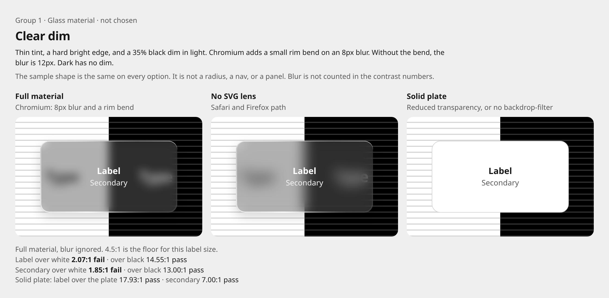
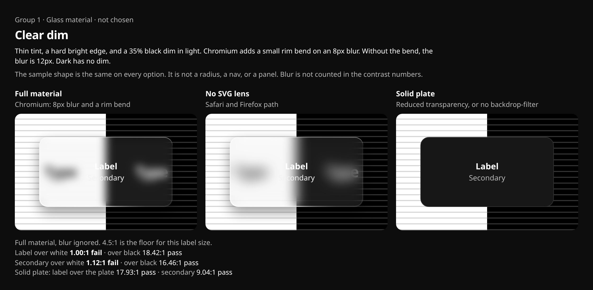
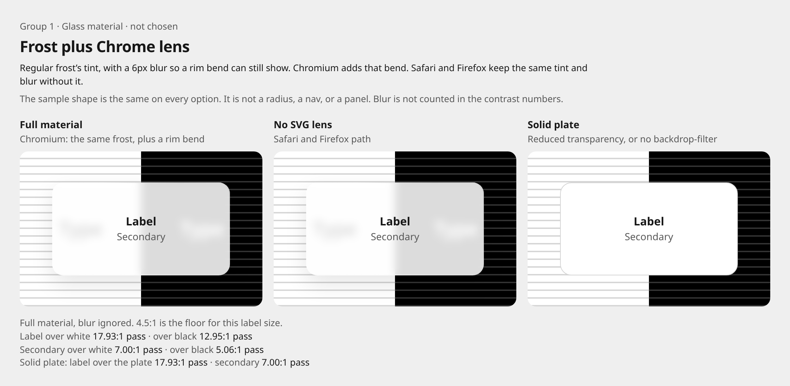
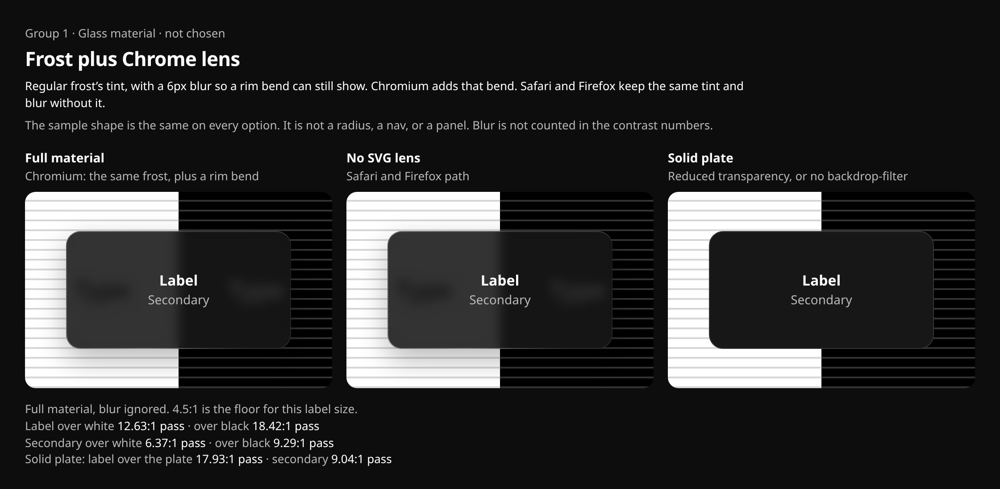

# Glass material options

Group 1 only. Nothing here is chosen, and none of it is on the site.

The sample shape is identical across the three options so it does not decide a radius, a nav, a dock, or a panel. Type size, spacing, hero, and motion are not in this comparison. Each capture shows the same label over a split field: white on the left, black on the right, with hairline stripes. Contrast ratios composite the tint on pure white and pure black. Blur is not given credit.

Open `preview/glass-material/index.html` in a browser. The file follows the system light or dark setting. `?option=regular`, `?option=lens`, `?option=clear`, or `?option=chrome`, and `?theme=light` or `?theme=dark`, are review switches for this file only.

Screenshots were taken in Chrome 156 on this machine. Safari and Firefox were not run here. The middle column drops the SVG lens and is the stand-in for those engines. The right column is the solid plate.

## Regular frost

Thicker tint, 20px blur, a quiet 1px edge. No refraction, so Chrome, Safari, and Firefox get the same glass as long as `backdrop-filter: blur()` works.

Light fill `rgba(255,255,255,0.86)`, saturate 1.12, text `#171717`, secondary `#595959`. Dark fill `rgba(23,23,23,0.88)`, saturate 1.05, text `#ffffff`, secondary `#b8b8b8`.

Label and secondary both clear 4.5:1 on white and on black.

| | Label on white | Label on black | Secondary on white | Secondary on black |
| --- | --- | --- | --- | --- |
| Light | 17.93:1 pass | 12.95:1 pass | 7.00:1 pass | 5.06:1 pass |
| Dark | 12.63:1 pass | 18.42:1 pass | 6.37:1 pass | 9.29:1 pass |

The tightest pair is secondary text on the light glass over black, at 5.06:1. Reduced transparency, and a browser without `backdrop-filter`, replace it with a solid plate: white `#ffffff` in light, coal `#171717` in dark. That plate passes (label 17.93:1; secondary 7.00:1 in light and 9.04:1 in dark). Chrome was checked with `prefers-reduced-transparency: reduce`: the blur drops and the plate is solid white. There is no SVG filter to lose.

## Thin lens

Thinner tint and a brighter 1.5px edge. In Chromium the sample uses an 8px blur plus a rim displacement (scale 16, no rainbow split). Safari and Firefox do not apply `backdrop-filter: url(#svg)`, so they keep the tint and a 28px blur and skip the bend. WebKit bug [245510](https://bugs.webkit.org/show_bug.cgi?id=245510) is the Safari gap. Firefox has the same hole.

Light fill `rgba(255,255,255,0.38)`. Dark fill `rgba(18,18,18,0.40)`. Text colors match Regular frost.

The rim bend shows up as a smear of whatever sits under the edge. The label on the glass stays sharp. The tint does not.

| | Label on white | Label on black | Secondary on white | Secondary on black |
| --- | --- | --- | --- | --- |
| Light | 17.93:1 pass | 2.89:1 fail | 7.00:1 pass | 1.13:1 fail |
| Dark | 2.61:1 fail | 20.14:1 pass | 1.32:1 fail | 10.15:1 pass |

Light glass fails on black. Dark glass fails on white. Blur hides some of that in the screenshot and disappears when transparency is reduced or `backdrop-filter` is missing. The solid plate is the same as Regular frost, and it passes. The SVG pass is Chromium-only and is one extra filter on a small sample. It is not animated.

## Clear dim

Thin tint, a hard 2px edge, and a small rim bend (scale 10) on an 8px blur in Chromium. Without the bend, the blur is 12px. Light uses a 35% black dim under the glass, which is Apple’s conditional example for Clear over bright content, not a token. Dark uses no dim. Text on the glass is white in both themes. The solid fallback does not keep that white text in light; it uses the same passing plate as the other options.

Light fill `rgba(255,255,255,0.16)` over the dim. Dark fill `rgba(255,255,255,0.08)`.

| | Label on white | Label on black | Secondary on white | Secondary on black |
| --- | --- | --- | --- | --- |
| Light | 2.07:1 fail | 14.55:1 pass | 1.85:1 fail | 13.00:1 pass |
| Dark | 1.00:1 fail | 18.42:1 pass | 1.12:1 fail | 16.46:1 pass |

White text disappears on the white half. In dark, with no dim, white on white is 1.00:1. The solid plate passes, same as the others. Safari and Firefox lose the bend and keep the thin tint, the dim in light, and the 12px blur, which does not fix the failed pairs.

## Frost plus Chrome lens

Added after checking the libraries linked from the posts. Live-page refraction does not run in Safari or Firefox. The libraries that stay clean do not send an SVG `backdrop-filter` to those engines. They keep a blur and a tint, and Chromium is the only one that also bends the rim.

This sample uses Regular frost’s tint, so the contrast numbers match Regular frost, and a 6px blur, so the bend is not wiped out by 20px of blur. Chromium adds a rim displacement on top. The middle column is the same tint and the same 6px blur with no bend. That is the Safari and Firefox path. The solid plate is unchanged.

| | Label on white | Label on black | Secondary on white | Secondary on black |
| --- | --- | --- | --- | --- |
| Light | 17.93:1 pass | 12.95:1 pass | 7.00:1 pass | 5.06:1 pass |
| Dark | 12.63:1 pass | 18.42:1 pass | 6.37:1 pass | 9.29:1 pass |

The label on the glass stays sharp. Reduced transparency still swaps every column for the solid plate. The bend is a Chromium-only extra filter. A wide bar that keeps a lens on while scrolling is the kind of cost called out in the Flipkart note, so this sample stays a small plate.

## What was checked

Refraction of the live page did not pass for Safari or Firefox. A clean frost fallback did pass, which is why the fourth sample exists.

| Source | Refraction in Safari and Firefox | Fallback |
| --- | --- | --- |
| [@onlymoein/liquidglass](https://github.com/onlymoein/liquidglass) | No on the live page. Firefox can bend a marked image. Safari cannot. | Same colour, blur, and rim, with no bend. Reduced transparency goes fully tinted. |
| [nordify/css-liquid-glass](https://github.com/nordify/css-liquid-glass) (Timur Butt, also the css-liquid-glass post) | No. The code treats `navigator.userAgentData` as Chromium and skips the map everywhere else. | Blur and saturate only. Their own veil is thin (about 0.14), so this sample keeps Regular frost’s thicker tint instead. |
| [@vepando/liquid-glass-react](https://github.com/LeonardSEO/liquid-glass-react) | No. The readme says other engines accept the syntax and then draw nothing, so a CSS fallback rule is not reliable. | Frost, and a solid surface under reduced transparency. The lens `url()` is added only in Blink. |
| [Fluid Kit](https://fluidkit.mogilnikov.dev/) `@fluidkit/blur` | No lens at all. | The material is the frost. Same in every browser. |
| [Liquid Glass Kit](https://github.com/wpsydev/liquid-glass-kit) | The post says the SVG lens is opt-in and Chromium-only. | CSS frost by default. The research file did not return its body, so this row follows the post. |
| `@glass-sdk/liquid-glass` on [0x3f4.run](https://0x3f4.run) | WebGPU. The author says iOS Safari was the hard part. | Not a CSS frost path I could confirm. |
| X Spaces Dock | Native, not a web library. | Not a material option. Where a dock sits is a later group. |

Chrome 156 on this machine is the only engine that was launched. Safari and Firefox were not. The middle column is the gated frost those libraries describe, not a screenshot from those browsers.

## Recommendation

Use Regular frost when a glass material is eventually placed. Frost plus Chrome lens passes the same contrast test, and its bend is real only in Chromium and easy to lose under a tint this thick. Thin lens and Clear dim still fail on the hostile half of the field.

This is a recommendation. It is not applied to a page, a token, or a component.

## The choice

Pick one material: Regular frost, Thin lens, Clear dim, or Frost plus Chrome lens.

Placement, radius, type, hero, nav, panels, and motion stay open. None of the three options add rainbow fringes.

## Sources

- [Apple HIG: Materials](https://developer.apple.com/design/human-interface-guidelines/materials) — Liquid Glass is the functional layer. Regular adjusts luminosity for legibility. Clear stays more transparent and, over bright content, may need a dim. They are different variants.
- [Meet Liquid Glass, WWDC25](https://developer.apple.com/videos/play/wwdc2025/219/) — lensing, a specular edge, tint that shifts for legibility, no glass-on-glass, and Reduced Transparency making the material frostier.
- [MDN `backdrop-filter`](https://developer.mozilla.org/en-US/docs/Web/CSS/Reference/Properties/backdrop-filter) — blur is cross-browser in current engines. An SVG `url()` filter is not.
- [WebKit bug 245510](https://bugs.webkit.org/show_bug.cgi?id=245510) — `backdrop-filter: url(#filter)` does not displace in Safari.
