# Personal site directions

Research only. Captured 11 November 2026. No application code, Figma file, or copy change is proposed for implementation here.

Peter Cheng (程钟泉 / Zhongquan Cheng) is an Analyst at Deloitte China Technology & Transformation. His work is agentic systems and applied AI: LLM orchestration, RAG, and backend. This note does not add biography, project outcomes, or a public name beyond those facts.

Two earlier notes set the constraints:

- The rebrand note chooses **idea B** as the base: project cards told as problem, architecture, and result, plus a small ask box that answers only from the site. A text version of **idea A** (an AI Peter) can follow. Voice and spectacle stay in a later version. [The X post](https://x.com/RajveeerrSingh/status/2107166753533120729) is the named reference.
- The 25 October 2026 brand guideline replaces the earlier paper, ink, and signal-orange palette, and it does not approve a type family. The current visual direction is coal, black, and white. Green appears only as the period after Deloitte in the employment line. Glass belongs on navigation, not on case studies. Motion explains a change. Evidence outranks decoration. The brand font, the public name, dark versus light, and the public project list are still open.

The pages below were opened in a 1440×900 desktop browser. Each note covers layout, the first screen, how work is shown, interaction and motion, how the brand shows up, and what fits the guideline.

The post itself, fetched the same day, reads: “my site is live: rajveers.com” and then names an AI you can type or talk to, a lake you can fish with a phone, and architecture on every project. At that fetch it showed about 10.2k views, 102 likes, and 110 bookmarks. The linked site is [rajveers.com](https://rajveers.com/).

---

## Three directions

| Direction | What a visitor meets first | What carries the brand | Place in the work |
| --- | --- | --- | --- |
| Quiet index | Name and one sentence on an almost empty field | Type, space, and a single next step | The shell of the site |
| Diagram case study | A problem, then one picture of the system | The diagram and the decision that produced it | The inside of each project |
| Measured notebook | A dated list of notes, evals, or prototypes | The archive, including limits and unfinished work | Later, once there is writing to file |

---

## 1. Quiet index

A short page. The person, the work, and one next step are visible without a scene, a metric wall, or a second hue.

### Paco Coursey — [paco.me](https://paco.me/)

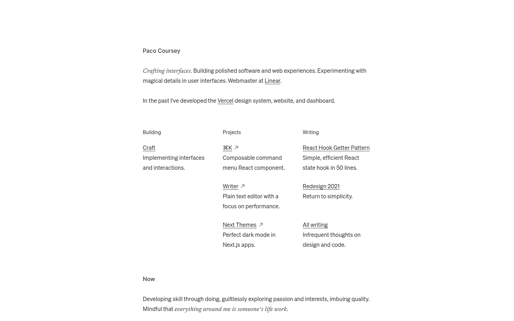

**What is good.** The page is a document. “Paco Coursey” is a modest heading, not a poster. One italic sentence says what he does, a second sentence says where he did it, and the page splits into Building, Projects, and Writing. Every item is a name plus one sentence. Underlined links are the only strong affordance. There is no card chrome and no visible motion.

**Fit.** This is the closest layout to the guideline’s reading column, 60–72 character body, and “one next action.” Project cards can stay this short on the index: title, one sentence, role and year, then a destination. Leave the personal “Now” essay and the italic voice until Peter approves copy. The page is light; coal remains an open default, with this structure working on either field.

### Emil Kowalski — [emilkowal.ski](https://emilkowal.ski/)

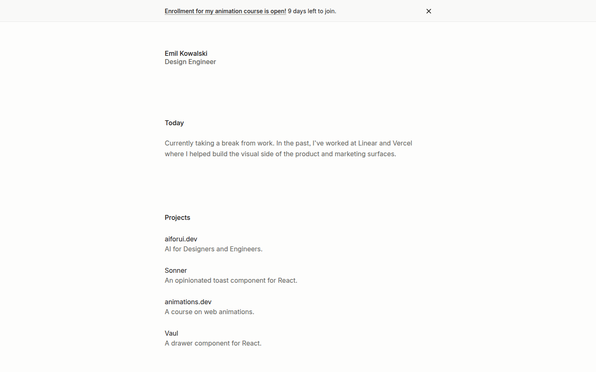

**What is good.** Same skeleton, stacked instead of columned: name, role, Today, Projects, Writing. Projects are products a stranger can identify in one line (Sonner, Vaul, animations.dev). The writing titles do as much branding as the layout. His essay [You Don’t Need Animations](https://emilkowal.ski/ui/you-dont-need-animations) is the motion reference worth keeping: give an animation a purpose, skip it on actions people repeat all day, keep interface motion generally under 300ms, use ease-out when something enters or leaves, and honor reduced motion.

**Fit.** That essay supports the guideline’s short durations (120ms feedback, 280ms navigation) and the choice to leave the PC identity gesture off on load. A course banner across the top is his business, not a pattern for this site. His project lines are the right weight for an index of three or four pieces of work.

### Rauno Freiberg — [rauno.me](https://rauno.me/)

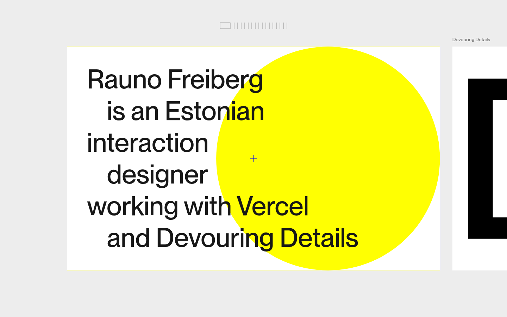

**What is good.** One sentence fills the viewport: who he is, and the two places the work lives. A yellow circle is the only chromatic decision, and it sits behind the type rather than replacing it. The next surface (Devouring Details) is already peeking in, so the page admits it is one panel in a series. Craft studies live beside the biography. The sentence does not wait on them.

**Fit.** Borrow the confidence of a single readable sentence and the separation between identity and studies. Translate the circle into the existing monochrome PC mark, at rest, and only if that mark is approved. Do not add a yellow, or any other accent. The sideways craft rail is a portfolio of interaction studies; Peter’s equivalent is a case study, not a strip of experiments. Glass, if used, stays on the navigation and does not frost this first sentence.

---

## 2. Diagram case study

The index stays quiet. Opening a project shows the system: problem, a small diagram, the decision, the evidence, and the limit. One drawing grammar repeats across projects.

### Om Jaiswal — [omjaiswal.dev/engineer](https://omjaiswal.dev/engineer)

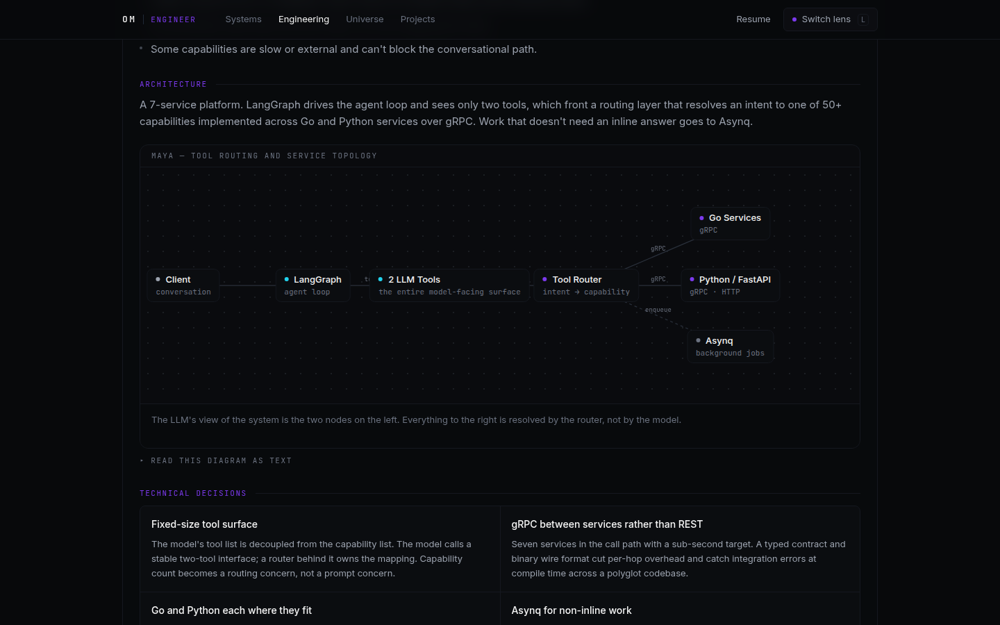

**What is good.** The engineer view is a case study, not a gallery. A project states the problem, what he owned, then a diagram with a one-sentence caption: the model sees two tools, and a router resolves the rest. Under the picture, decisions are written as claims (“Fixed-size tool surface”) with a reason. The page also offers “Read this diagram as text,” so the picture is not the only explanation. Sections run problem, constraints, architecture, decisions, trade-offs, implementation, result.

**Fit.** This is idea B, and it matches the guideline’s case-study order: claim, responsibility, evidence, trade-off, limitation. Keep the text alternative, the left-to-right flow, and a cap around seven nodes on the card. Draw nodes in the neutral palette. Labels and line style (solid, dashed, dotted) carry the meaning that his purple dots carry now. Do not import his metrics, his employer’s product names, or the dark theme as a settled choice. Dark is the proposed default, still open.

### Anthropic, “Building effective agents” — [anthropic.com/research/building-effective-agents](https://www.anthropic.com/research/building-effective-agents)

The older `/engineering/building-effective-agents` path redirected here on 11 November 2026. The article is dated 19 December 2024 and says the tooling landscape has changed since.

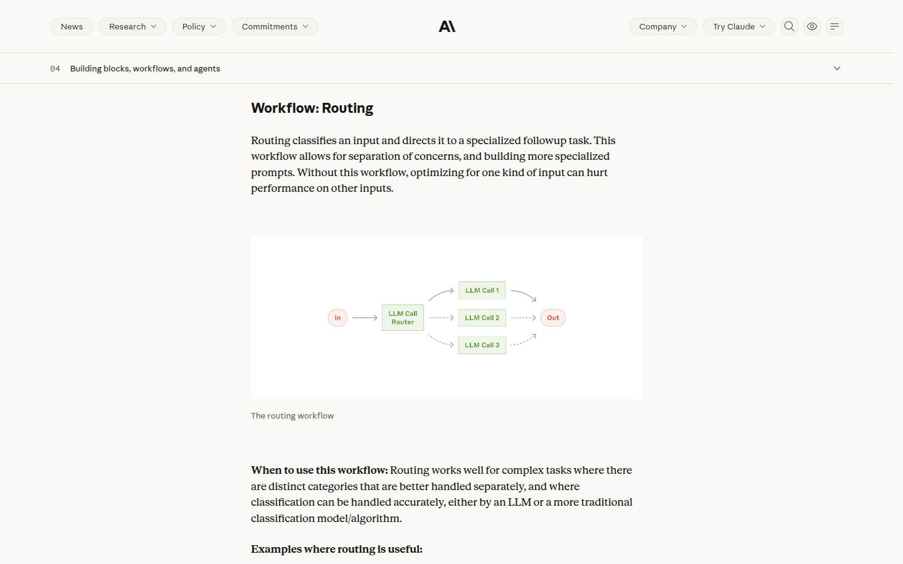

**What is good.** Each workflow gets one diagram, one caption (“The routing workflow”), and a short “when to use this” note. Prompt chaining, routing, parallelization, orchestrator-workers, and evaluator-optimizer share one drawing grammar. The picture explains a single idea. The prose says when not to use the pattern.

**Fit.** This is the reusable diagram system in the guideline: the same shapes across case studies, a caption, and a sentence of limitation. Rebuild it in coal and white. The green boxes and the distinct Out node are doing work that labels and line weight should do instead. Green stays reserved for the Deloitte period. These diagrams are reference drawings of public patterns, not claims about Peter’s projects.

### Sam Rose — [samwho.dev/load-balancing](https://samwho.dev/load-balancing/)

The essay is dated 10 April 2023 and was updated 25 October 2026.

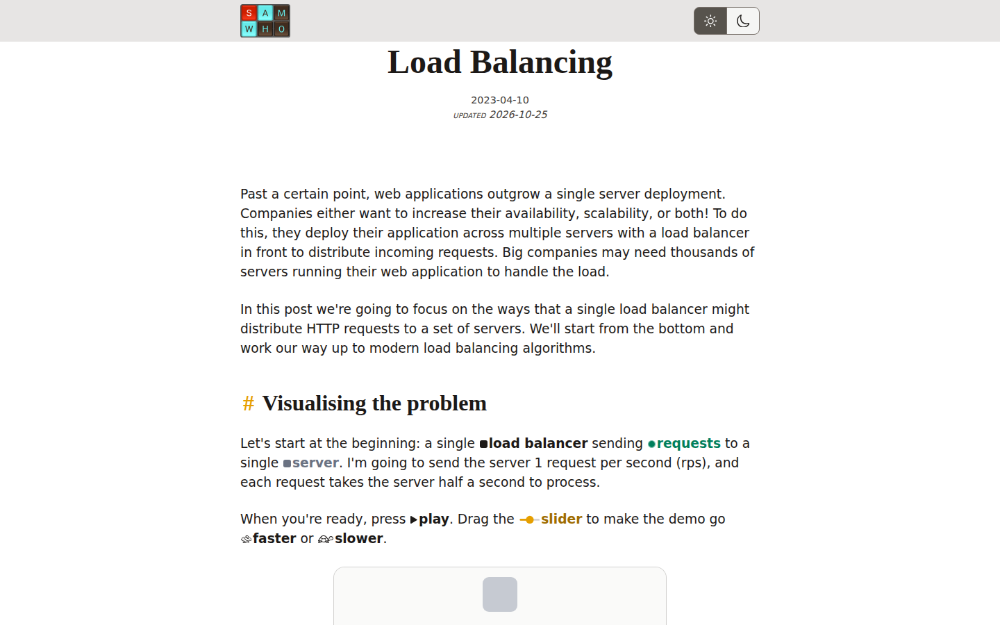

**What is good.** He starts from one load balancer and one server, names the rate and the cost, and only then asks the reader to press play. Complexity is added in public. The homepage is a portrait and a keyboard; the brand shows up in the essays, where a picture and a paragraph take turns.

**Fit.** Borrow the pace for a case-study detail page: the simplest true picture first, then the real constraint. Leave the playable simulation and the color-coded vocabulary (a color per kind of thing). The guideline already sets interactive diagrams aside because of cost, and it forbids relying on color to explain a flow. A still diagram plus a caption does this job.

### Rajveer Singh — the reference — [rajveers.com](https://rajveers.com/)

The site the post links to. Two screens, because the post is selling three different ideas at once.

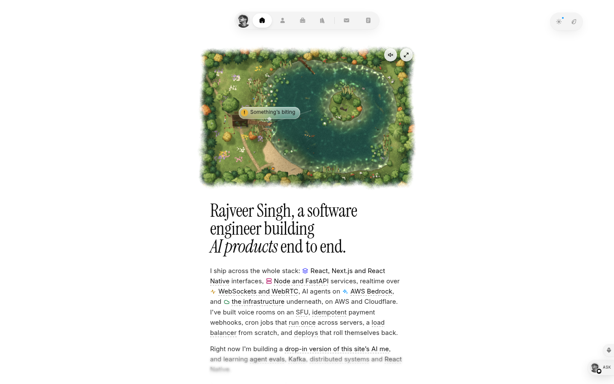

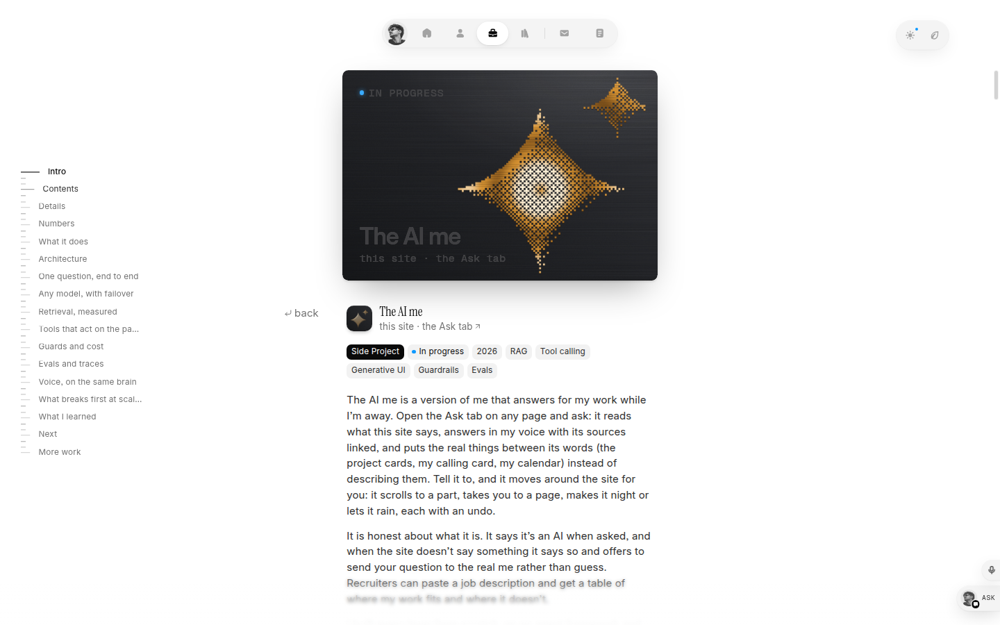

**What is good, in layers.**

- **Architecture writing.** The homepage gives each job a “How it fits together” sentence, then a link inward. Project pages use a sticky contents rail, a metadata line (kind of work, year, stack), and prose that includes refusals: the agent says it is an AI, and when the site is silent it hands the question to him instead of guessing. The [evals essay](https://rajveers.com/blog/evals-that-keep-an-agent-honest) describes 44 questions against the real model, retrieval gated in CI, a versioned prompt, and a trace under each answer.
- **The ask box.** “The AI me” is itself a project. Typed questions get cited answers and, on request, the page scrolls, navigates, or changes theme. Voice uses the same engine.
- **The lake.** The first screen is a WebGL scene. Full screen, a phone can be the fishing rod over WebRTC. The [lake essay](https://rajveers.com/blog/a-lake-that-never-makes-the-page-wait) is explicit that the text paints first and the scene costs nothing when it is offscreen.

**Fit.** Keep the third layer’s *writing* pattern and treat the first two as a boundary.

| From the post | For this site |
| --- | --- |
| Every project, with the architecture | Yes. One sentence on the card, one diagram on the detail page, same grammar every time. |
| An AI you can type to | Later, and only as text. Answers come from approved site copy, cite the passage, and say when the site does not know. No voice in the first release. |
| An AI that acts on the page while it speaks | Out. Navigation, theme, and weather stay human controls. |
| A lake you fish with your phone | Out. It fights the coal field, the “no WebGL” motion rule, the performance budget, and the requirement that evidence be more memorable than the interface. |

His serif headline, emoji stack labels, pill navigation, and generative cover are his brand. They are not an approval of Instrument Serif, a mono stack, or a display face for Peter. The type family stays open.

---

## 3. Measured notebook

A dated archive for someone whose credibility is how he checks the work. Useful once there is public writing. Heavy to launch on an empty shelf.

### Maggie Appleton — [maggieappleton.com](https://maggieappleton.com/)

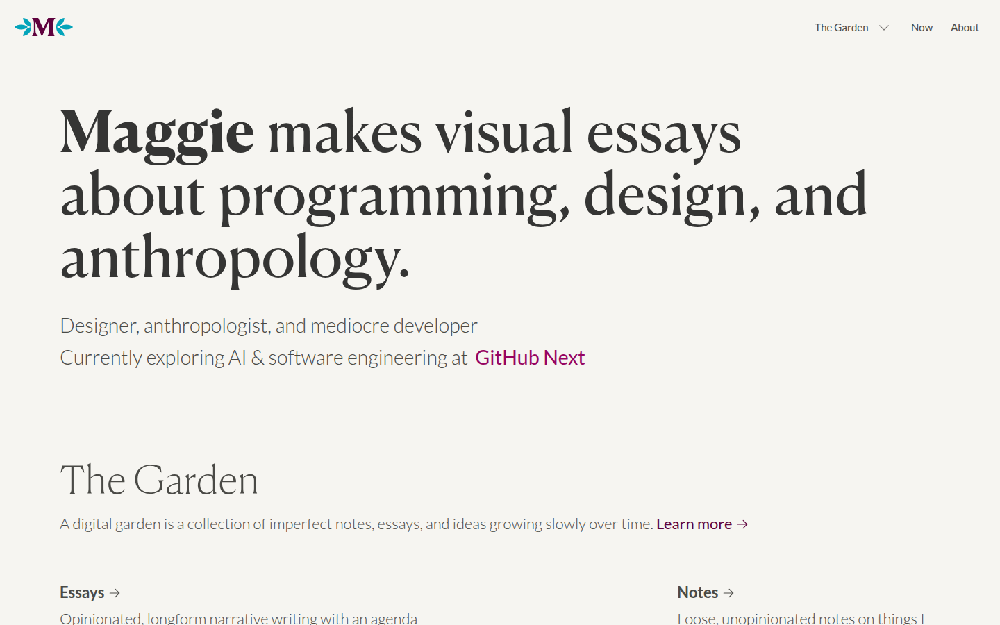

**What is good.** The first screen is one sentence about the work, then a role line. Below that, the garden separates kinds of knowledge: Essays (a position), Notes (not understood yet), Patterns (a reusable observation). A visitor can tell how finished an idea is before reading it. Illustrations and a serif display face make it hers. The page marks 2026.

**Fit.** If Peter publishes, split verified case studies from looser notes so a sketch never looks like a result. That serves an analyst who is expected to show the limit of a claim. Do not launch the garden structure, the illustrated mark, or a magenta link color in order to look like this page. Patterns, if they appear, use the same neutral diagram grammar as the case studies.

### Hamel Husain — [hamel.dev](https://hamel.dev/)

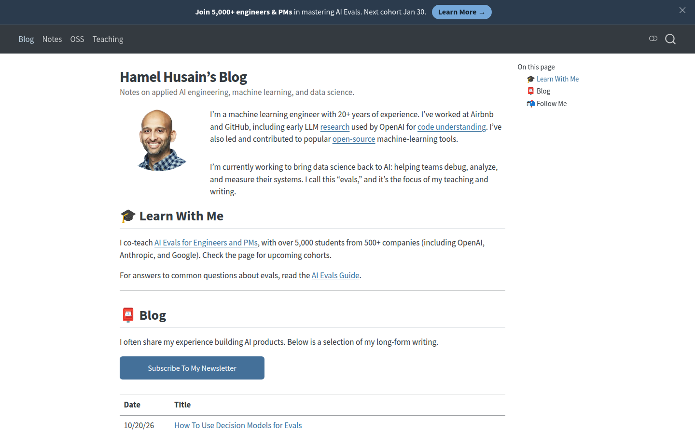

**What is good.** The homepage is a blog: who he is, what he means by evals, then a table of date and title. The subject is measurement. Titles make arguments (“Your AI Product Needs Evals,” “It’s Hard to Eval Is a Product Smell”). A visitor can see a trail of public claims and when they were made.

**Fit.** This is the tone of evidence the guideline asks for, in a calmer register than his headlines. A short notes index can sit beside case studies later. The course banner, the newsletter button, and the documentation-theme chrome should not become the first screen. His student counts and employer history are his, and they are not a template for Peter’s biography.

### Eugene Yan — [eugeneyan.com](https://eugeneyan.com/)

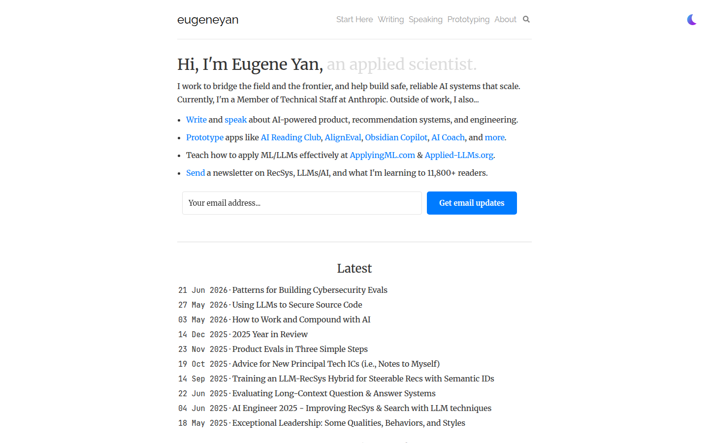

**What is good.** “Hi, I’m Eugene Yan, an applied scientist.” Four bullets say what he does, each with a destination. Latest is a dated list, including 2026 pieces on evals. Prototyping is its own section: small builds with a date, a repository, and a demo, including work he labels as an exploration rather than a product.

**Fit.** Borrow the dated line and the habit of linking the artifact. A prototype Peter is willing to show can live as a note with a date and a link, clearly separate from a case study. The newsletter field is his main capture; this site’s primary action is still an open decision, and a signup box should not occupy it by default.

---

## Recommendation

Build the **quiet index**, and make each selected project open into a **diagram case study**. That is idea B, drawn in the current coal, black, and white system: a sentence on the first screen, three or four projects, one diagram grammar, opaque reading surfaces, and motion only for state changes.

Hold the **measured notebook** and the text ask box until the decisions below are made. The ask box, if it is approved, is typed, cites the page it used, and says when the site does not know. Voice, a page-driving agent, and the lake stay out.

Nothing in this note chooses the font, the public name, the theme, the project list, or a metric.

---

## Open decisions for Peter

These are unresolved in the guideline. This research does not pick them.

1. **Positioning line.** The earlier candidates are not approved copy. Confirm the sentence a stranger should remember, or rewrite it.
2. **Public name and domain.** Peter Cheng, Zhongquan Cheng, 程钟泉, or a combined form, used the same way in the title, navigation, and link previews. Confirm the domain.
3. **Brand font.** One family, its weights, its license, and Chinese coverage if a Chinese version ships. No earlier proposal is approved, including any Deloitte-context face and any three-family split from the first draft.
4. **Appearance.** Coal as the default, a light theme, or follow the system. Whether a theme control is visible.
5. **Audience and the primary action.** Who the first screen is for, and the single next step: view the work, read one case study, or make contact.
6. **Public projects.** Which three to five may be shown, with role, dates, and outcomes Peter can stand behind. Confidential material stays out. No number ships until it has a source.
7. **Text ask box.** In the first release, or held. If it ships, the fact list, the refusal rule, and a cost limit need an owner. Voice and page control are not part of this decision.
8. **Language.** English only at launch, or Chinese as well. A Chinese version needs its own copy and glyph check; an English specimen does not prove it.
9. **Contact.** An email link, a form, or another method that already works. No response-time promise.
10. **Employment line.** Confirm the Deloitte sentence is still accurate before the green period is published. The period is not a general accent.
11. **Pictures of the work.** Neutral framing is the default. Any full-color screenshot that must stay in color needs an explicit exception. Diagrams stay monochrome either way.
12. **Personal mark.** Whether a PC mark appears, and the approved vector if it does. The identity gesture stays off unless separately approved.
